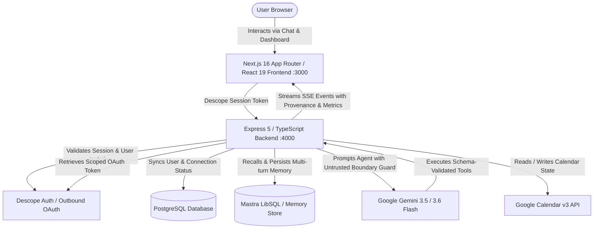
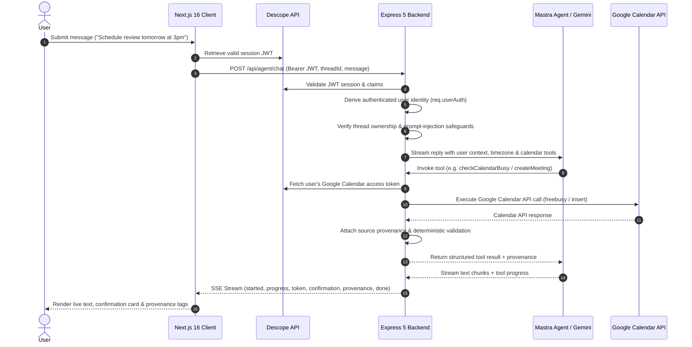

# Agentic Calendar Assistant — Architecture Specification

## 1. System Overview

The **Agentic Calendar Assistant** is an AI-powered conversational scheduling and meeting assistant. It bridges natural language conversational scheduling with Google Calendar v3 API via Descope Outbound Applications, utilizing Google Gemini (with resilient fallback mechanisms) orchestrated via Mastra agent workflows and PostgreSQL/LibSQL persistence.

---

## 2. Component Topology

### 2.1 Frontend (`frontend/`)
- **Framework**: Next.js 16.3.0 App Router with Turbopack, React 19.2.8, Tailwind CSS v4.
- **Authentication**: `@descope/nextjs-sdk` managing user session lifecycle, login redirect, and Bearer token acquisition.
- **Client Features**:
  - Landing page with interactive agent simulator.
  - Protected Dashboard (`/dashboard`) requiring verified session.
  - Streaming Chat Panel (`components/dashboard/chat-panel.tsx`) consuming Server-Sent Events (SSE).
  - Outbound Google Calendar connection panel (`components/dashboard/connection-panel.tsx`).

### 2.2 Backend (`backend/`)
- **Server**: Express 5.2.1 running with TypeScript (Node.js ES Modules).
- **Session Authentication & User Sync**:
  - `requireSession` middleware validates Descope Bearer session tokens via `descopeClient.validateSession`.
  - Maps external authentication claims to internal PostgreSQL `users` table via `ensureUser`.
- **Database & Persistence**:
  - PostgreSQL client via `pg` connection pool (`pool.ts`).
  - Tables: `users`, `connections`, with migrations runner in `scripts/migrate.ts`.
- **Agent Orchestration**:
  - Mastra Core (`@mastra/core/agent`) executing parameterized tool calls.
  - Working memory and thread store managed by `@mastra/memory` and `@mastra/libsql`.
- **Calendar Integration**:
  - Google Calendar v3 SDK via `googleapis`.
  - Outbound OAuth access tokens fetched dynamically via Descope Outbound Applications Management API.
- **Protocol Extensions**:
  - Optional Model Context Protocol (MCP) server mounted via `@descope/mcp-express`.

---

## 3. End-to-End Request Lifecycle

---

## 4. Security & Isolation Architecture

1. **Identity Derivation**: All calendar operations, thread access, and database records derive their user identity exclusively from the cryptographically verified Descope session token claims (`sub`). No client-supplied user identity parameters are trusted.
2. **Thread Isolation**: Conversation threads in Mastra memory are explicitly bound to the authenticated user's `authUserId`. Cross-user thread access is rejected with a 404/403.
3. **Prompt-Injection Defense**: User messages, calendar event titles, descriptions, and attendee strings are demarcated as untrusted external content. Instructions inside calendar event descriptions cannot override assistant safety policies or bypass action authorization.
4. **Least-Privilege Scoping**: Calendar tokens are retrieved on-demand per request and never stored in frontend storage, URL parameters, or client responses.
