# Production Upgrade Improvement Plan

## 1. Roadmap & Phased Execution

```mermaid
graph LR
    P1[Phase 1: Audit & Builds] --> P2[Phase 2: Auth & Security]
    P2 --> P3[Phase 3: Calendar Tools & Safe Writes]
    P3 --> P4[Phase 4: Source Provenance]
    P4 --> P5[Phase 5: Evaluation Suite]
    P5 --> P6[Phase 6: Observability & Costs]
    P6 --> P7[Phase 7: Fallback & Recovery]
    P7 --> P8[Phase 8: Frontend Experience]
    P8 --> P9[Phase 9: Verification & Release]
```

---

## 2. Detailed Phase Breakdown

### Phase 1: Repository Audit & Reproducible Builds
- Fix backend TypeScript type collision on `Express.Request` caused by `@descope/mcp-express`.
- Ensure clean compilation for both frontend and backend (`npm run build`).
- Set up unit testing harness (Vitest) in `backend` with TypeScript support.
- Audit package scripts and document runtime entry points.

### Phase 2: Authentication, Per-User Authorization, & Prompt-Injection Protections
- Replace unverified JWT decoding in MCP tools with cryptographic token validation.
- Implement thread ownership validation in `streamAgentReply` to prevent cross-user thread hijacking.
- Sanitize and encapsulate external calendar descriptions with strict untrusted boundary markers.
- Define system security policies rejecting prompt-injection attempts from calendar payloads.
- Enforce per-user resource boundaries and rate-limiting middleware on all endpoints.

### Phase 3: Calendar Tool Correctness, Timezones, & Safe Write Actions
- Upgrade Zod input schemas with strict ISO-8601 validation, chrono-ordering (`start < end`), and email format verification.
- Support dynamic IANA timezone resolution (user-specified or detected from request header/memory), replacing hardcoded offsets.
- Remove server-timezone pollution in `listUpcomingMeetings` when calculating day bounds.
- Introduce `searchEvents` tool for querying meetings by title, description, and attendee.
- Introduce conflict detection logic prior to scheduling or rescheduling.
- Implement two-phase safe write actions: require user confirmation for destructive or consequential operations (create, reschedule, cancel).
- Implement idempotency keys and pre-creation state reconciliation to prevent duplicate meetings.

### Phase 4: Source Provenance & Action Verification
- Define typed provenance data structures (`SourceProvenance`):
  - `sourceType`: `'calendar_api' | 'freebusy' | 'user_preference' | 'inferred'`
  - `retrievalTimestamp`, `eventId`, `timeRange`, `confidence`, `evidence`, `traceId`.
- Attach provenance metadata to all calendar tool outputs.
- Stream provenance events via SSE to the client (`type: "provenance"`).
- Verify state on Google Calendar immediately following write operations before reporting success.

### Phase 5: Evaluation Dataset, Automated Regression Tests, & Safety Gates
- Create a comprehensive evaluation test dataset (`evals/scenarios.json`) covering:
  - Standard meeting creation, rescheduling, and cancellation.
  - Conflict resolution and free/busy queries.
  - Multi-timezone scheduling and DST transitions.
  - Ambiguous time interpretations.
  - Cross-user thread isolation and unauthorized action rejection.
  - Malicious prompt injection inside event descriptions.
  - Network timeout and API failure recovery.
- Build automated test runner calculating:
  - Task completion rate.
  - Tool selection & argument accuracy.
  - Conflict detection precision & recall.
  - Prompt injection bypass rate (target: 0%).
  - Unauthorized write execution rate (target: 0%).
- Establish release gates blocking builds if security tests fail.

### Phase 6: Cost Tracking, Latency Instrumentation, & Observability
- Instrument full request lifecycle using monotonic timestamps:
  - Request received -> Auth validated -> Agent started -> Model call duration -> Tool call duration -> Calendar API duration -> Time to first token -> Response complete.
- Track token usage (prompt tokens, completion tokens, cached tokens) and compute costs using versioned pricing tables.
- Generate unique correlation IDs (`x-request-id` / `traceId`) across logs, SSE streams, and audit records.
- Create structured audit logging for sensitive actions (creation, modification, cancellation).

### Phase 7: Fallback, Retries, Uncertain-Write Reconciliation, & Streaming Recovery
- Implement resilient model fallback (Gemini primary -> secondary provider/model) with parameter and tool compatibility checks.
- Add bounded exponential backoff with jitter for Google Calendar API transient errors (500, 503, 429).
- Implement uncertain-write reconciliation: if network drops during `createMeeting`, query calendar by client request ID / idempotency token before retrying.
- Support client abort signals and clean socket disconnection on SSE streams.

### Phase 8: Frontend Improvements & Operational UX
- Update `ChatPanel` with:
  - Confirmation cards for consequential write actions (title, start/end, timezone, attendees, conflicts, confirm/cancel buttons).
  - Visual source provenance badges ("Verified via Google Calendar", "Calculated availability").
  - Timezone indicator and selector.
  - Granular progress indicators (model planning, executing tool, verifying calendar).
  - Graceful reconnection and error recovery prompts.

### Phase 9: End-to-End Verification & Release Report
- Run end-to-end integration tests and mock test suites.
- Verify TypeScript builds, linting, and evaluation metrics.
- Generate exhaustive Release Report detailing all verified issues, fixes, metrics, and operational prerequisites.
